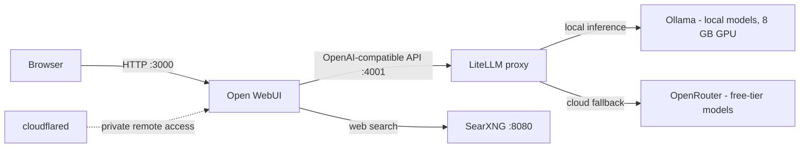

# homelab-ai-stack

[](https://github.com/sjhnandez/homelab-ai-stack/actions/workflows/ci.yml)
[](https://github.com/sjhnandez/homelab-ai-stack/actions/workflows/ci.yml)

A self-hosted AI stack for a single home server: [Open WebUI](https://openwebui.com/) as the chat front end, [LiteLLM](https://docs.litellm.ai/) as the one OpenAI-compatible endpoint every client talks to, [Ollama](https://ollama.com/) running local models on an 8 GB GPU, [OpenRouter](https://openrouter.ai/) free-tier models as elastic cloud fallback capacity, [SearXNG](https://docs.searxng.org/) backing private web search, and a Cloudflare Tunnel for private remote access. Everything is deployed with Docker Compose.

## Architecture



Chat traffic flows browser to Open WebUI to LiteLLM, which fans out to local Ollama deployments and OpenRouter's free models. SearXNG sits behind Open WebUI and answers its web-search queries. A `cloudflared` sidecar can publish the stack through a Cloudflare Tunnel, so no inbound ports have to be opened on the router.

## Model routing

Every client — Open WebUI, scripts, or anything OpenAI-compatible — points at the LiteLLM proxy (`:4001`) and authenticates with `LITELLM_MASTER_KEY`. The routing rules live in `litellm/config.yaml`:

- **Aliases.** `text-chat` and `vision-chat` group the free deployments by modality; `free-chat` is a single public alias backed by the complexity router; a catch-all `openrouter/*` wildcard lets any OpenRouter model be requested by name.
- **Load balancing.** `simple-shuffle` spreads requests across the free deployments. `num_retries: 5` retries on another endpoint, and `allowed_fails: 0` with `cooldown_time: 120` benches a deployment for 120 seconds after its first failure, so traffic moves to healthy siblings immediately.
- **Silence-gap timeouts.** `timeout` and `stream_timeout` are 20 seconds — explicitly *silence-gap* limits, not total-duration caps: a request is killed and rerouted only when nothing (or no stream chunk) arrives for 20 seconds. A steady stream is never interrupted, so long answers are safe while stalled connections are caught fast.
- **Fallbacks.** Recoverable failures are rerouted instead of being surfaced to the client: `text-chat` and `vision-chat` fall back to each other, and `free-chat` falls back to `[text-chat, vision-chat]`. This also catches streaming errors that arrive before the first content chunk.
- **Complexity routing.** `free-chat` uses LiteLLM's `auto_router/complexity_router`: each request is classified into a tier (SIMPLE / MEDIUM / COMPLEX route to `text-chat`, REASONING routes to `vision-chat`), and `modality_routing` pins image-bearing requests to vision-capable deployments.

## Free-model sync

Free model catalogs rotate constantly, so `litellm/update_free_models.py` keeps the deployments in `config.yaml` fresh — a cron job runs it every 3 hours:

- Rewrites only the block between the `BEGIN/END AUTO FREE MODELS` markers in `config.yaml`, splitting models into the `text-chat` (text-only) and `vision-chat` (image input) groups.
- Probes every candidate with a minimal live request before adopting it, dropping models that are gated or dead (HTTP 403/404) while keeping transient failures (429/5xx/network).
- Flags: `--dry-run` (show what would change), `--restart` (rewrite and recreate the LiteLLM container), `--no-probe` (metadata-only).
- Tuning knobs in the script: `PINNED_MODELS`, `EXCLUDE_PATTERNS`, `MIN_CONTEXT`, `MAX_TEXT_MODELS`, `MAX_VISION_MODELS`.

## VRAM budgeting

The GPU is an 8 GB RTX 3070 Ti (laptop) shared with the desktop session and Jellyfin NVENC transcodes, so Ollama is tuned to stay fully GPU-resident:

- `OLLAMA_FLASH_ATTENTION=1` and a `q8_0` KV cache roughly halve KV memory with negligible quality impact.
- `OLLAMA_MAX_LOADED_MODELS=1` — one model loaded at a time; anything more cannot fit in 8 GB.
- `OLLAMA_CONTEXT_LENGTH=15360` is the measured maximum that keeps a 9B q4 model 100% GPU-resident on this card (16k already starts ~12% CPU offload).
- `OLLAMA_GPU_OVERHEAD` reserves ~512 MB for the desktop and NVENC so they never fight the model for the last gigabyte.
- Fit rule: keep model weights at or below ~6 GiB of the 8 GB; context and reserves are budgeted around that.

## Quickstart

```bash
git clone https://github.com/sjhnandez/homelab-ai-stack.git
cd homelab-ai-stack
cp .env.example .env
# Edit .env:
#   LITELLM_MASTER_KEY -> openssl rand -hex 32
#   OPENROUTER_API_KEY -> https://openrouter.ai/keys
#   APPS_TUNNEL_TOKEN  -> optional; only needed for Cloudflare Tunnel remote access
docker compose config -q   # validate the compose file
docker compose up -d
```

The chat UI is then available at <http://localhost:3000>.

The `ollama` service expects an NVIDIA GPU with the NVIDIA container runtime registered on the host.

## Not included in this repo

This repository is curated to be public and secrets-free. The following pieces of the live deployment are intentionally omitted (see `.gitignore`); the Compose services that reference them remain in `docker-compose.yaml` for completeness:

- `profile/` — the personal profile site, maintained in its own repository.
- `portal/` — the apps-portal dashboard template and assets.
- `open-webui/` and `ollama/` — runtime data directories (database, uploads, vector store, downloaded models, keys).
- `searxng/settings.yml` — contains a generated `secret_key`; copy `searxng/settings.example.yml` and generate your own.

## License

MIT — see [LICENSE](LICENSE).
